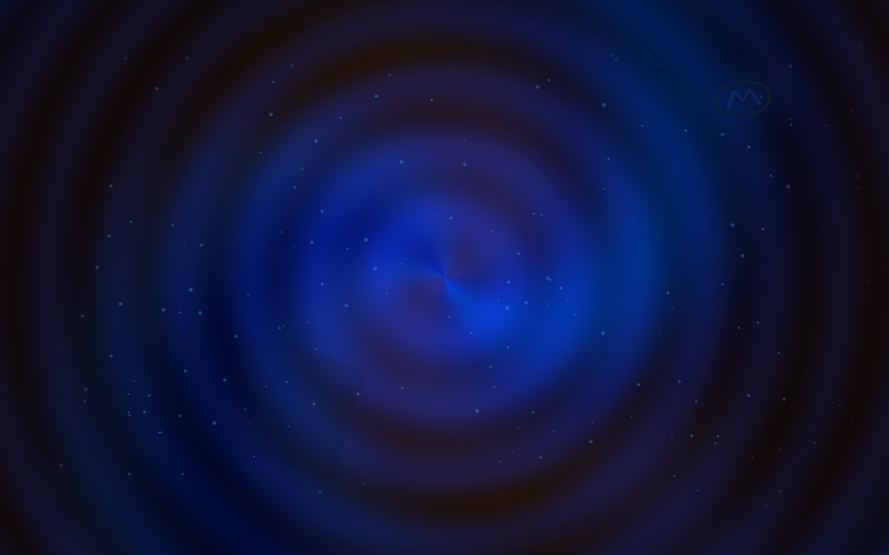
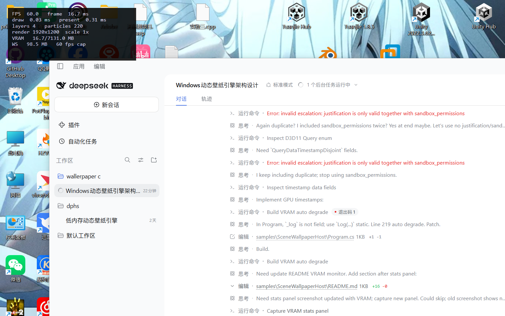
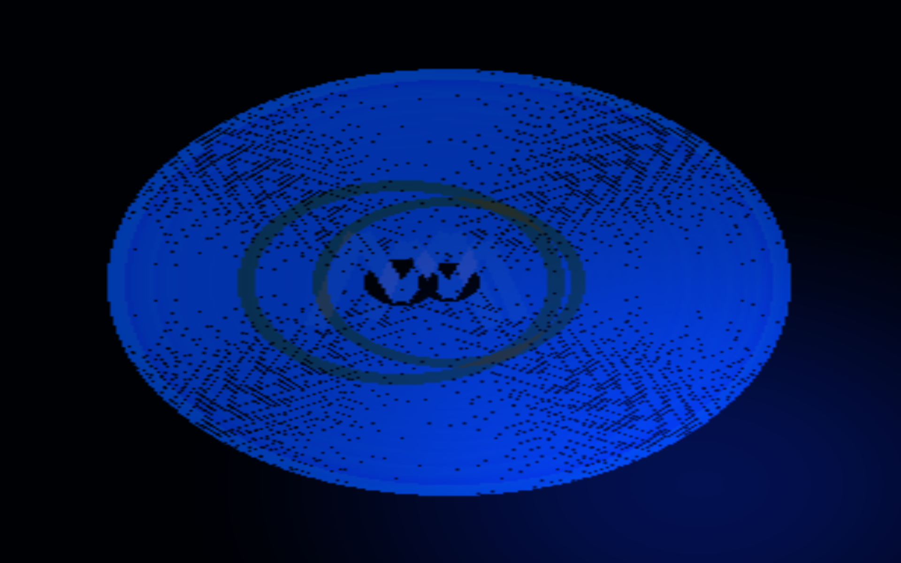

# SceneWallpaperHost（阶段 4：Silk.NET DirectX 11 2D 场景）



> 本阶段按需求使用 **Silk.NET Direct3D11** 实现；渲染器位于子进程边界之后，后续可在 `SceneRenderer` 接口/程序集层面替换为 Vortice 或其他后端，不影响父进程与 IPC。

## 本轮优化（相对上一版）

- **补上真实粒子层**：`particles` 图层，CPU 模拟 + 动态 VB + GPU 圆点；`maxParticles` 与 4096 硬上限生效；示例 220 个，构造 5000 个会截断到 1024。
- **QuickJS 不再能被单帧死循环拖死**：`QuickJSRuntime.Interrupt` 50ms 预算；死循环被中断、脚本禁用、渲染继续；单帧 ops 上限 256。
- **DXBC 缓存**：按 GLSL/HLSL 源哈希缓存，第二次启动跳过 D3DCompile。
- **贴图按路径共享**：相同图片被多个图层引用时只上传一次；8×2048² 场景 VRAM 191.5MB → 41.6MB。
- **超采样/半分辨率**：1x/2x/4x 离屏渲染 + 最终 blit；`--half-res` 降级到 0.5x；用于 GPU 压力测试。
- **GPU 压力用例**：`scenes/gpu_stress`（512 次循环 trig/noise），4x 下实测 28.7fps，1x 60fps。
- **统计面板**：`--stats` 显示实时 FPS/frame/draw/present/图层/粒子/分辨率/内存；IPC `stats` 可切换。
- **BC3/BC7 纹理压缩**：PNG 加载自动编码；BC3 16×2K VRAM 362.7→84.3MB；BC7 走 BCnEncoder（256² 验证通过，2K CPU 编码约 9s，建议离线预压缩）。
- **GLSL 多贴图**：`uniform sampler2D` + `texture()`，层 `textures` 列表映射 t0..tN / s0..sN；示例 `scenes/multitex`。
- **视口裁剪/Resize**：屏幕外图层跳过 Draw；窗口尺寸变化重建 RTV/离屏目标/交换链。
- **VRAM 监控/GPU 时间戳**：DXGI `QueryVideoMemoryInfo` + D3D11 timestamp query；面板显示 used/budget 和 GPU ms。
- **保持原有能力**：shader/color/image/particles、音频、帧率锁、图片 mipmap 全部回归通过。

一个独立的 2D 场景壁纸子进程：

- Silk.NET.Direct3D11 + DXGI，WorkerW 全屏 swapchain
- 图片 / 纯色 / GLSL 片段着色器图层
- 图层位置、缩放、旋转、透明度动画
- QuickJS 每帧执行 `update(dt)`，通过 `layer.*` / `getLayer()` 改属性
- 系统音频 WASAPI loopback → 32 段 FFT → shader constant buffer + QuickJS
- 帧率锁定、最大贴图尺寸、自动 Mipmap、真实粒子层 + `maxParticles` 硬上限
- QuickJS 50ms/帧中断、256 ops/帧上限、DXBC 着色器缓存

## 1. 架构

```text
SceneWallpaperParent.exe
  ├─ WASAPI loopback (NAudio) → 1024 FFT → 32 log bands
  ├─ 30Hz stdio JSON: {"cmd":"audio","bins":[...],"level":...}
  └─ 启动/停止子进程
        │
        ▼
SceneWallpaperHost.exe
  ├─ 共享 WorkerWWindow（/samples/Shared/WorkerWRuntime）
  ├─ D3D11 device + DXGI swapchain（WorkerW HWND）
  ├─ SceneRenderer
  │    ├─ color  layer → fixed PS
  │    ├─ image  layer → texture + mipmap + fixed PS
  │    └─ shader layer → GLSL → HLSL → D3DCompile → PS
  ├─ SceneScript (QuickJS)
  │    ├─ 每帧更新 time/input/audio
  │    ├─ 调用用户 update(dt)
  │    └─ JSON ops → apply layer position/opacity/scale/rotation
  ├─ 60/30 FPS 帧率锁 + 1ms timer resolution
  └─ stdin: stop / pause / resume / status / audio
```

进程边界：

- 主程序/父进程只管音频、生命周期、控制。
- 场景子进程管 WorkerW、D3D11、脚本、渲染。
- 子进程 stdin 关闭即退出；父进程崩溃不会留下写壁纸的子进程。
- 渲染线程就是主消息线程：`PumpMessages()` → 脚本 → 渲染 → `Present`。

## 2. 目录

```text
samples/SceneWallpaperHost/
  Program.cs              # 子进程、IPC、主循环、鼠标、FPS
  SceneRenderer.cs        # D3D11 设备/交换链/图层/纹理/着色器
  GlslTranslator.cs       # GLSL 子集 → HLSL
  SceneScript.cs          # QuickJS 绑定、每帧 ops
  SceneConfig.cs          # scene.json
  scenes/audio_gradient/
    scene.json
    scene.js
    shader.glsl
    logo.png
samples/SceneWallpaperParent/
  Program.cs              # 启动子进程 + 音频
  （链接 WebWallpaperParent/AudioSpectrum.cs）
```

## 3. 构建与运行

依赖 NuGet：

- `Silk.NET.Direct3D11` 2.23.0
- `Silk.NET.DXGI` 2.23.0
- `QuickJS.NET` 0.0.3（含 win-x64 `quickjs.dll`）
- `System.Drawing.Common`（通过 `Microsoft.WindowsDesktop.App` FrameworkReference，用于 PNG 解码）

```powershell
$build = "$env:USERPROFILE\WallerpaperBuild"

dotnet build "D:\Desktop\wallerpaper c\samples\SceneWallpaperHost\SceneWallpaperHost.csproj" `
  -c Release -o "$build\scenehost"

dotnet build "D:\Desktop\wallerpaper c\samples\SceneWallpaperParent\SceneWallpaperParent.csproj" `
  -c Release -o "$build\sceneparent"

& "$build\sceneparent\SceneWallpaperParent.exe" `
  --child "$build\scenehost\SceneWallpaperHost.exe" `
  --scene "$build\scenehost\scenes\audio_gradient\scene.json" `
  --seconds 15
```

参数：

```text
--fps 30|60         帧率锁
--seconds N         自动停止（测试）
--pause-after N     启动 N 秒后 pause 2 秒再 resume（测试）
--no-audio          不启动 WASAPI
--vsync             仅测试用：Present(1,0)，测真实显示节流；默认 Present(0,0)
--supersample 2|4  离屏 2x/4x 渲染 + blit 到屏幕（GPU 压力测试）
--half-res          0.5x 离屏渲染 + 放大（高负载降级）
--stats             显示 topmost 统计面板；IPC `stats` 可切换
```

从低完整性工作区构建时，EXE 可能继承 Low 标签，`SetParent` 会失败；请从桌面原生 PowerShell 构建/运行到 `%USERPROFILE%\WallerpaperBuild`。

DPI：子进程启动时调用 `SetProcessDpiAwarenessContext(-4)`，否则 1920×1200 桌面在 125% 缩放下会得到 1228×768 的客户区。

## 4. 核心渲染循环

[`Program.cs`](Program.cs)

```csharp
timeBeginPeriod(1);
while (_running)
{
    worker.PumpMessages();

    // 帧率锁
    if (now < nextFrame) { SleepUntil(nextFrame); continue; }

    // 1) QuickJS：time/input/audio -> update(dt) -> JSON ops
    var ops = _script.Update(_scriptTime, dt, mouse.X, mouse.Y, audio);
    _renderer.ApplyScriptOps(ops);

    // 2) D3D11：逐图层绘制 -> Present(0,0)
    _renderer.Render(_scriptTime, dt, mouse.X, mouse.Y, audio, config.Fps);

    nextFrame = now + 1.0 / config.Fps;
}
timeEndPeriod(1);
```

渲染器内部：

```csharp
UpdateSceneConstants(time, mouseX, mouseY, audio); // b0
ClearRenderTargetView(RTV, dark);
OMSetRenderTargets(RTV);
RSSetViewports(viewport);
RSSetState(rasterizerCullNone);
VSSetShader(fullscreenTriangleVS);
PSSetConstantBuffers(0, sceneCB);
PSSetConstantBuffers(1, layerCB);
PSSetSamplers(0, linearMipSampler);
OMSetBlendState(alphaBlend);

foreach (layer in drawOrder)
{
    UpdateLayerConstants(layer);       // b1
    PSSetShader(layer.PixelShader);
    PSSetShaderResources(layer.Srv);
    Draw(3, 0);                        // full-screen triangle
}
Present(0, 0);                         // host-controlled pacing
```

全屏三角形由 `SV_VertexID` 生成，不需要顶点缓冲/输入布局：

```hlsl
float4 main(uint id : SV_VertexID) : SV_Position
{
    float2 p = float2((id << 1) & 2, id & 2);
    return float4(p * 2.0 - 1.0, 0, 1);
}
```

每个图层在像素着色器里做逆变换，计算图层局部 `uv`：

```hlsl
float2 ComputeUV(float2 pixel)
{
    float2 d = pixel - L0.zw;            // L0.zw = center px
    float s = sin(-L2.x), c = cos(-L2.x); // L2.x = rotation
    d = float2(c * d.x - s * d.y, s * d.x + c * d.y);
    d /= max(abs(L1.zw), 0.0001);        // L1.zw = scale
    return d / max(L1.xy, 1.0) + 0.5;    // L1.xy = layer size px
}
```

超出 `[0,1]` 的像素 `discard`，从天然支持位置/缩放/旋转/裁切。

### 超采样与统计面板

`--supersample 2|4` 创建 `screen * scale` 的离屏 RGBA8 目标；场景绘制到离屏 RTV，再用全屏 blit PS 采样到 backbuffer：

```csharp
// 离屏
_context->OMSetRenderTargets(1, &sceneRtv, null);
RSSetViewports(renderWidth, renderHeight);
// ... layers ...
// 最终 blit
_context->OMSetRenderTargets(1, &backRtv, null);
RSSetViewports(screenWidth, screenHeight);
PSSetShader(blitPs);
PSSetShaderResources(0, 1, &sceneSrv);
Draw(3, 0);
```

- `--half-res` = 0.5x，同样走离屏 blit。
- `--stats` 创建 topmost、click-through 的 WinForms 诊断窗口，显示：
  - FPS / frame ms
  - draw/present ms
  - layer/particle 数
  - render 分辨率/scale
  - working set
- IPC `stats` 切换面板。



#### VRAM 监控与自动降级

- `ID3D11Device → IDXGIDevice → IDXGIAdapter3`
- `QueryVideoMemoryInfo(0, MemorySegmentGroup.Local, &info)` 读取 `CurrentUsage/Budget`
- stats 输出 `vramUsedMb/vramBudgetMb`，面板显示 `VRAM used/budget`
- 当 `used > min(adapterBudget, maxTextureMemoryMb) * 0.9`：
  - 自动调用 `SetRenderScale(0.5)`，释放并重建离屏/交换链目标。
  - 注意：半分辨率主要降低填充成本，**不会减少贴图本身占用的 VRAM**；贴图预算仍需要 LRU/压缩。

实测：

```text
VRAM monitor: used=6.8MB budget=7131.0MB
stats: vramUsedMb=16.7, vramBudgetMb=7131
```

## 5. 图层系统

[`SceneRenderer.cs`](SceneRenderer.cs)

### scene.json

```json
{
  "name": "audio-gradient",
  "script": "scene.js",
  "maxParticles": 1024,
  "maxTextureSize": 2048,
  "fps": 60,
  "layers": [
    {
      "name": "main",
      "type": "shader",
      "shader": "shader.glsl",
      "position": [0.5, 0.5],
      "size": [1.0, 1.0],
      "scale": [1.0, 1.0],
      "rotation": 0.0,
      "opacity": 1.0
    },
    {
      "name": "orb",
      "type": "color",
      "color": [0.20, 0.65, 1.0, 1.0],
      "position": [0.25, 0.72],
      "size": [0.16, 0.16],
      "opacity": 0.12
    },
    {
      "name": "sparks",
      "type": "particles",
      "count": 220,
      "particleSize": 3.0,
      "color": [0.35, 0.75, 1.0, 0.85],
      "position": [0.5, 0.5],
      "size": [0.9, 0.8],
      "opacity": 0.45
    },
    {
      "name": "logo",
      "type": "image",
      "image": "logo.png",
      "position": [0.82, 0.18],
      "size": [0.18, 0.18],
      "opacity": 0.90
    }
  ]
}
```

坐标约定：

- `position`：`0..1` 屏幕归一化中心；
- `size`：`0..1`，图层宽高相对屏幕；
- `scale`：相对 `size` 的缩放；
- `rotation`：弧度；
- `opacity`：`0..1`，最后乘到 alpha/颜色；
- 图层数组顺序就是绘制顺序。

### 图层类型

| type | 实现 | 说明 |
|---|---|---|
| `color` | 固定 PS | `tint * opacity`，支持 alpha 混合 |
| `image` | 固定 PS + Texture2D/Sampler | PNG/JPG → BGRA8；最大尺寸裁剪；自动 mipmap |
| `shader` | GLSL→HLSL→PS | 全屏/图层局部 uv，自定义片段着色器 |
| `particles` | CPU 模拟 + 动态 VB + GPU 四边形 | 数量受 `maxParticles`/4096 硬上限约束；音频驱动速度/脉冲 |

关键绘制代码：

```csharp
foreach (var layer in _layers)
{
    if (!layer.Visible || layer.Opacity <= 0.001f) continue;
    UpdateLayerConstants(layer);
    _context->PSSetShader(layer.PixelShader, null, 0);
    if (layer.Srv != null)
        _context->PSSetShaderResources(0, 1, &layer.Srv);
    _context->Draw(3, 0);
}
```

### 视口裁剪 / Resize

- 每帧计算图层旋转后的 AABB；完全在 `[0,renderW]×[0,renderH]` 外就跳过 Draw，统计在 `culledLayers`。
- `ResizeToClient()` 每秒检查客户区；尺寸变化时：
  - 释放 scene RTV/SRV；
  - `ResizeBuffers(2, w, h, R8G8B8A8_UNORM, 0)`；
  - 重建 backbuffer RTV 和离屏目标。
- 多显示器/混合 DPI 仍需要 per-monitor swapchain；当前是主屏 WorkerW 的尺寸变化路径。

### 粒子层

[`ParticleLayer.cs`](ParticleLayer.cs)：

```csharp
Count = Math.Clamp(Math.Min(cfg.Count, maxParticles), 0, MaxHardwareParticles);

// 每帧 CPU 模拟 220 个粒子，写 6 顶点/粒子到 dynamic VB
p.X += p.Vx * step * speed;
p.Y += p.Vy * step * speed;
var radius = _particleSize * p.Size * pulse;
```

D3D11 只负责：

```text
VS: pixel position -> clip position
PS: dot(local,local) <= 1 ? soft circle : discard
```

粒子上限：

- `maxParticles` 配置级；
- 单层再受 `MaxHardwareParticles = 4096` 硬上限；
- 动态 VB 按 `maxParticles` 预分配；实际 draw count 由 `BuildVertices` 返回。

构造 `count=5000` 的测试场景时日志：

```text
particle layer 'sparks' count=1024 (max=1024)
```

### 自动 Mipmap / 贴图上限

```csharp
var desc = new Texture2DDesc
{
    Width = (uint)w, Height = (uint)h,
    MipLevels = 0,                    // full mip chain
    Format = Format.FormatB8G8R8A8Unorm,
    BindFlags = (uint)(BindFlag.ShaderResource | BindFlag.RenderTarget),
    MiscFlags = (uint)ResourceMiscFlag.GenerateMips
};
CreateTexture2D(...); CreateShaderResourceView(...);
_context->GenerateMips(srv);
```

`w/h` 先被 `maxTextureSize` 限制；`GenerateMips` 只在上传时执行一次。

### BC3 压缩与显存

`scene.json` 可指定：

```json
{ "textureCompression": "bc3", "maxTextureSize": 2048, "maxTextureMemoryMb": 512 }
```

- `rgba`：原 BGRA8 + mipmap（默认，保持旧行为/最高质量）。
- `bc3`：PNG 解码后 CPU 编码 BC3/DXT5，上传 `FormatBC3Unorm`，无运行时 mip 生成。
- `bc7`：CPU 编码 BC7，上传 `FormatBC7Unorm`；质量更高但编码慢，见下。
- `auto`：≥512×512 的贴图自动 BC3。

实测 16×2048²：

```text
RGBA8（mipmap）: 362.7MB dedicated VRAM / 707.4MB private
BC3:             84.3MB dedicated VRAM / 259.2MB private
```

BC3 理论压缩比 4:1（RGBA8 4B/px → BC3 1B/px）；实际节省约 77%，还包含 base texture/driver 开销。

注意：

- BC3 有色块/渐变 banding，适合壁纸背景，不适合精细文字/线稿；
- 当前 BC3 路径只上传 base mip；需要完整 mip 时应离线生成 DDS mip 链；
- **BC7**：通过 MIT `BCnEncoder.Net` 自动编码（`textureCompression: "bc7"`），保留 alpha、质量优于 BC3；但 CPU 编码很慢：
  - 256×256：可用，8 图层共享一张时启动正常；
  - 2048×2048：约 9s/张，8 张会超过 15s ready 超时——生产应离线生成 BC7 DDS 或异步预计算。
- **auto** 当前对 ≥512² 使用 BC3（速度/质量折中），不会自动选 BC7。
- 压缩纹理目前只上传 base mip；完整 mip 链应离线生成 DDS。

## 6. GLSL 片段着色器

自定义文件：[`scenes/audio_gradient/shader.glsl`](scenes/audio_gradient/shader.glsl)

```glsl
#version 330
uniform float time;
uniform vec2 mouse;
uniform vec2 resolution;
uniform float audioLevel;
uniform float audioBass;
out vec4 fragColor;

void main()
{
    vec2 uv = gl_FragCoord.xy / resolution;
    // ...
    fragColor = vec4(col, 1.0);
}
```

宿主提供的内置变量：

| GLSL 名 | 含义 |
|---|---|
| `time` | 秒 |
| `mouse` | 屏幕像素坐标 |
| `resolution` | 屏幕像素尺寸 |
| `uv` | 当前图层局部 uv（宿主计算） |
| `audioLevel` | 总电平 0..1 |
| `audioBass` / `audioMid` / `audioTreble` | 低/中/高平均 |
| `audioLow` / `audioHigh` | FFT bins 0..3 / 4..7 的 vec4 |
| `fragColor` | 输出颜色 |

转换流程：

```text
.glsl 文件
  → 去 #version/uniform/out 声明
  → vec* → float*；mix→lerp；fract→frac；atan(y,x)→atan2
  → void main() → void UserMain()
  → 注入 SceneParams/LayerParams cbuffer、ComputeUV、wrapper main
  → D3DCompile ps_5_0
  → CreatePixelShader
```

同时写出 `shader.glsl.hlsl.generated` 方便排查翻译问题。

### 自定义 sampler2D / 多贴图

layer 可声明 textures：

```json
{
  "type": "shader",
  "shader": "multitex.glsl",
  "textures": ["tex0.png", "tex1.png"]
}
```

```glsl
uniform sampler2D texA;
uniform sampler2D texB;

vec3 a = texture(texA, uv).rgb;
vec3 b = texture(texB, uvB).rgb;
```

翻译结果：

```hlsl
Texture2D texA : register(t0);
SamplerState texA_s : register(s0);
Texture2D texB : register(t1);
SamplerState texB_s : register(s1);
texA.Sample(texA_s, uvA)
```

渲染时按 `textures` 顺序绑定 `t0..tN`，同一个 linear mip sampler 绑定到 `s0..sN`。示例：[multitex.glsl](samples/SceneWallpaperHost/scenes/multitex/multitex.glsl)、截图 [scene-multitex.png](docs/assets/scene-multitex.png)。



当前仍**不支持**：

- 自定义 vertex shader / 真正的多个 varying（现有 vertex stage 固定为全屏三角形，`uv` 由图层变换计算）；
- MRT、`#include`、复杂预处理、samplerCube；
- 任意 GLSL ES 语法。

这是有意的轻量方案：避免引入 glslang/SPIRV-Cross 运行时和额外 native 依赖。需要完整 GLSL 时应改成离线 SPIR-V/HLSL 编译，或在 `SceneRenderer` 后接另一后端。

## 7. QuickJS 绑定

[`SceneScript.cs`](SceneScript.cs)  
[示例 scene.js](scenes/audio_gradient/scene.js)

Prelude 暴露：

```js
const time  = { time: 0, deltaTime: 0 };
const input = { mouseX: 0, mouseY: 0, mouseDown: false };
const audio = { level: 0, bass: 0, mid: 0, treble: 0, bins: [] };

const layer = getLayer('main');
layer.setPosition(x, y);
layer.setOpacity(v);
layer.setScale(x, y);
layer.setRotation(radians);
layer.setParticleCount(n);          // 0..maxParticles
layer.setParticleSpeed(v);          // 0..20, 1.0 = 默认

getLayer('logo').setOpacity(0.8);
```

用户脚本只定义 `update(dt)`：

```js
const PARTICLE_COUNT = 220;
const PARTICLE_SPEED = 1.0;

function update(dt) {
    const t = time.time;
    layer.setOpacity(0.90 + 0.10 * Math.sin(t * 1.6));
    layer.setScale(1.0 + audio.bass * 0.035, 1.0 + audio.bass * 0.035);

    const orb = getLayer('orb');
    orb.setPosition(0.25 + 0.05 * Math.sin(t * 0.55),
                    0.72 + 0.04 * Math.cos(t * 0.83));
    orb.setOpacity(0.08 + audio.level * 0.12);
    orb.setScale(1.0 + audio.bass * 0.30, 1.0 + audio.bass * 0.30);

    const sparks = getLayer('sparks');
    sparks.setOpacity(0.28 + audio.level * 0.5);
    sparks.setScale(1.0 + audio.bass * 0.12, 1.0 + audio.bass * 0.12);
    sparks.setParticleCount(PARTICLE_COUNT);
    sparks.setParticleSpeed(PARTICLE_SPEED);
}
```

实测修改脚本参数：

```text
PARTICLE_COUNT 220 → 900
PARTICLE_SPEED 1.0 → 3.0
stats: particles=900, scriptOps=13, fps=60.1
```

画面粒子密度同步增加；默认值仍是 220/1.0。

每帧宿主做：

```csharp
// 1. 更新 JS 全局对象
time.time = ...; time.deltaTime = ...;
input.mouseX = ...; audio.level = ...; audio.bins = [...];

// 2. 调用用户帧函数
if (typeof update === 'function') update(time.deltaTime);

// 3. 取出 JS 层属性命令（批量 JSON，不把 .NET 对象暴露给 JS）
JSON.stringify(__ops.splice(0, __ops.length));
```

C# 反序列化 `ScriptOp[]` 后应用到对应 layer：

```csharp
switch (op.Op)
{
    case "position": layer.PositionX = op.X.Value; ... break;
    case "opacity":  layer.Opacity = Clamp(op.Value.Value, 0, 1); break;
    case "scale":    layer.ScaleX = ...; break;
    case "rotation": layer.Rotation = ...; break;
}
```

设计取舍：

- 不把 `ID3D11Layer` 或任意 .NET 对象传给 QuickJS，避免生命周期/GC 风险；
- 用 JSON ops 把脚本线程和渲染资源解耦；
- 每帧一次 `Eval`，实测 `scriptMs ≈ 0.24ms`（本机 1920×1200，4 图层）；
- 未来可把 setter 改成 native callback，减少 JSON 分配。

脚本安全：

- QuickJS 默认无文件/网络访问；不注入 host object；
- `QuickJSRuntime.Interrupt` 设置 **50ms/帧** 预算；死循环会被中断，脚本禁用，渲染器继续工作；
- 单帧 layer ops 上限 **256**，防止脚本刷爆队列；
- 脚本仍是受信内容；50ms 只是防止单帧冻结，不是完整沙箱。

## 8. 音频链路

[`../WebWallpaperParent/AudioSpectrum.cs`](../WebWallpaperParent/AudioSpectrum.cs) 被 Scene 父进程复用：

```text
默认输出设备 → WasapiLoopbackCapture
  → 32-bit float 采样
  → 1024 点 Hann + FFT
  → 32 个对数频段 40Hz..16kHz
  → 0..1 归一化
  → 30Hz stdio JSON
```

子进程收到 `audio`：

```json
{"cmd":"audio","bins":[0.1,...],"level":0.62}
```

同时：

- 写入 `SceneParams` constant buffer：`audioLevel/Bass/Mid/Treble/Low/High`；
- 写入 QuickJS `audio.level/bass/mid/treble/bins`；
- 脚本和 shader 都能用同一帧频谱。

实测：

```text
[parent] first audio spectrum level=0.965 bins=32
[stats] audioLevel:0.602, audioBass:0.092, fps:59.8
```

## 9. 性能控制与优化

### 已实现

| 控制 | 实现 |
|---|---|
| FPS 锁 | 主循环 `Stopwatch` + `timeBeginPeriod(1)`，实测 30.2 / 60.1 |
| 最大贴图尺寸 | `maxTextureSize` clamp，超过则高质量缩放 |
| 自动 Mipmap | `MipLevels=0` + `GenerateMips` |
| 最大粒子 | `maxParticles` 在 scene 加载时 clamp；单个粒子层再受 4096 硬件硬上限约束；示例 220 个 |
| 粒子提交 | CPU 每帧写 6 顶点/粒子到动态 VB，GPU 只做像素圆点；超出预算直接截断 |
| 无 vsync | `Present(0,0)`，由宿主控帧；避免 WorkerW/DWM 下 Present 阻塞多个 vblank |
| 常量缓冲 | Dynamic + `Map.WriteDiscard`，每帧一次 |
| 纹理只上传一次 | 场景加载期完成；运行期只采样 |
| 脚本预算 | 50ms/帧 interrupt + 256 ops/帧上限 |
| Shader 缓存 | SHA-256 源哈希 → `%TEMP%\Wallerpaper\SceneShaders\*.dxbc`，避免重复 D3DCompile |
| VRAM 监控 | DXGI `QueryVideoMemoryInfo`，stats/panel 输出 used/budget |
| GPU timestamp | D3D11 TimestampDisjoint + 两个 Timestamp query，输出 `gpuMs` |
| 视口裁剪 | 旋转 AABB 完全离屏时跳过 Draw，`culledLayers` 统计 |

### 实测（本机，1920×1200，4 图层，220 粒子，1 张 256×256 PNG）

| 目标 | 实际 FPS | CPU | Draw | Present | QuickJS | 工作集 |
|---|---:|---:|---:|---:|---:|---:|
| 30 + 粒子 | 30.2 | 0.4% | 0.06ms | 0.30ms | 0.21ms | 82.0MB |
| 60 + 粒子 + 音频 | 59.7 | 0.7% | 0.03ms | 0.29ms | 0.24ms | 98.8MB |

D3D11 feature level：`Level110`。  
音频只播放了测试旋律，频谱 32 bins；文件测试结束后无残留子进程。

### 60 秒 soak

同配置、60 FPS、持续音频/粒子：

```text
workingSet  86.0MB → 97.0MB
private     80.1MB → 90.4MB
FPS         59.9–60.1
CPU         0.2–0.7%
handles     538–545
```

60 秒内工作集在 92–97MB 间波动，没有持续单向增长；这不足以证明无泄漏，仍需 8h/24h + 专用显存（VRAM）监控。

### 负载边界（本机，vsync 测试）

用 `GPU Process Memory(*)\Dedicated Usage` 按 PID 采样进程专用显存：

| 场景 | FPS | 进程专用 VRAM | 工作集 | 私有内存 |
|---|---:|---:|---:|---:|
| 0 粒子 + 2 图层 | 60.1 | 20.1MB | 74.8MB | 73.8MB |
| 4000 粒子（4px） | 60.1 | 20.1MB | 78.5MB | 74.3MB |
| 4000 粒子（32px，铺满屏） | 60.1 | 20.1MB | 78.7MB | 75.0MB |
| 256 个全屏 color 图层 | 60.1 | 20.1MB | 77.8MB | 74.0MB |
| 1024 个全屏 color 图层 | 60.1 | 20.1MB | 91.5MB | 88.3MB |
| 8 张相同 2048² 贴图 | 60.1 | **41.6MB**（缓存前 191.5） | 111.5MB | 126.9MB |
| 8 张不同 2048² 贴图 | 60.1 | **191.5MB** | 224.2MB | 390.8MB |
| 16 张不同 2048² 贴图 | 60.1 | **362.7MB** | 368.3MB | 707.4MB |
| 8 张不同 2048²，BC3 | 60.0 | **52.2MB** | 200.2MB | 226.3MB |
| 16 张不同 2048²，BC3 | 60.1 | **84.3MB** | 201.6MB | 259.2MB |

结论：

- 粒子/图层/贴图负载下没有掉到 60fps 以下；1024 个全屏图层仍 60fps，`presentMs` 约 2.6ms。
- **重 shader + 超采样触发了真实 GPU 掉帧**：512 次循环 shader 在 1x=60.1、2x=53.4、4x=28.7fps。
- 当前常规场景瓶颈先是显存/内存；只有把 shader ALU/分辨率拉满时才转为 GPU 时间。
- **贴图缓存优化有效**：8 个图层共用同一张 2048² 贴图时，专用 VRAM 从 191.5MB 降到 41.6MB，私有内存从 390.8MB 降到 126.9MB。
- 16 张不同 2048² 贴图的 362.7MB VRAM 与 16×16MB+mipmap 的估算一致；这是当前测试的最高显存负载。
- 大量不同贴图时，私有内存 707MB 主要来自图片解码/上传缓冲；生产版应使用 BC7/BC3 压缩、按需流式加载和更严格的显存预算。

### GPU stress shader + 超采样

`scenes/gpu_stress`：单图层，512 次循环 trig/noise，`--vsync`。

| 渲染分辨率 | FPS | 结论 |
|---|---:|---|
| 1920×1200（1x） | 60.1 | 本机可承受 |
| 3840×2400（2x） | 53.4 | 开始掉帧 |
| 7680×4800（4x） | **28.7** | GPU 填充/ALU 上限，`gpuMs≈331.9` |

这个用例可用于对比不同 GPU、降压/降频、驱动版本和半分辨率策略。

### 瓶颈分析

1. **填充率/overdraw 是第一位**  
   示例是 1 个全屏 shader + 2 个小图层 + 220 个粒子四边形；自定义 shader 每像素包含 `sin/cos/pow/smoothstep` 和 alpha blend。  
   全屏填充仍是 4K/多全屏层的首要成本；高负载测试用 1024 个全屏 color 层，GPU 仍保持 60fps，说明本机填充率仍有 headroom。

2. **自定义 shader 的 ALU 成本**  
   `pow`、多层 `mix`、多条 `sin` 是 GPU ALU 热点；低端核显会先掉帧。  
   优化：预计算常量、减少 `pow`、把静态渐变烘焙成纹理、半分辨率渲染后上采样。

3. **每层一次全屏 draw，无批处理**  
   目前命令少、drawMs ~0.01ms；层数多了以后要合并/实例化/按脏矩形裁剪。  
   透明层应使用 `discard` 早退、避免大面积 overdraw，或使用 stencil/scissor。

4. **QuickJS + JSON**  
   `scriptMs` 0.2–0.3ms，当前可接受；每帧字符串/JSON 会产生 GC。  
   优化：native setter callback、复用 StringBuilder、批量更新、脚本字节码缓存、限制 ops 数量。

5. **无 vsync 的撕裂**  
   `Present(0,0)` 避免 DWM 阻塞，但会有 tearing；桌面壁纸可接受。  
   若需要平滑，使用 flip model + 允许 tearing，或在 DWM 环境用 `Present(1,0)` 并接受 pacing 偏差。

6. **纹理带宽/内存**  
   1920×1200 BGRA 单张约 9.2MB；mipmap +33%；多张大图会显著增加 VRAM。  
   优化：BC7/BC3 压缩、按屏幕尺寸裁剪、限制 mip 链、共享纹理。

7. **启动成本**  
   首次启动 D3DCompile + QuickJS + PNG 解码；GLSL 翻译仍每次启动重跑，但 DXBC 已按源哈希缓存，第二次启动跳过 D3DCompile。  
   进一步：缓存翻译后的 HLSL、异步加载、预编译官方 shader。

8. **多显示器/高 DPI**  
   当前按主屏 1920×1200 创建 swapchain；混合 DPI/多屏需要 per-monitor swapchain + 重新创建 RTV/纹理。

### 优化方向（按收益排序）

1. 降低无效填充：按图层裁剪、脏矩形、半分辨率 shader pass；
2. shader 降 ALU：烘焙静态噪声/渐变、减少 `pow/sin`、用 LUT；
3. 贴图压缩 + 尺寸预算；
4. 粒子已做 CPU 模拟 + 动态 VB + GPU 圆点；下一步可改为 instancing，进一步降低每帧顶点写入；
5. 批处理相同 shader/纹理的图层；
6. QuickJS 改 native setter（现已加 50ms interrupt + 256 ops 上限）；
7. DXBC 缓存已实现；进一步缓存翻译后的 HLSL/预编译官方 shader；
8. 使用 GPU timestamp 做真实 GPU 耗时监控（当前只有 CPU draw/present 计时）。

### 音频延迟/同步

父进程在每条 audio JSON 里带 `sentAt`，子进程统计当前帧收到的最后一条频谱的年龄：

```text
150 BPM 快节奏：first level=0.538，audioLevel=0.45，audioBass=1.00，audioAgeMs=29，59.9–60.1fps
 60 BPM 慢节奏：first level=0.221，audioLevel=0.49，audioBass=1.00，audioAgeMs=27，60.1fps
```

`audioAgeMs` 是 **IPC 排队到当前帧**的年龄（实测 17–29ms），不含：

- WASAPI 1024 样本 FFT 窗口（约 21ms @48kHz）；
- 父进程 33ms 定时采样；
- 显示/合成延迟。

因此从“声音进入扬声器”到“画面变化”的端到端延迟估计在 **50–80ms 量级**；对桌面壁纸可接受。快/慢节奏都能连续驱动同一帧的 shader 与脚本，没有观察到丢拍或卡顿。

## 10. 与 Wallpaper Engine Scene 的差异

| 维度 | 本实现 | Wallpaper Engine Scene |
|---|---|---|
| 渲染 | Silk.NET D3D11，自建 2D 图层 | 自研 Scene 渲染器，成熟 2D/3D |
| 脚本 | QuickJS，`update(dt)` + layer API | SceneScript，完整属性/事件/粒子/骨骼 |
| 着色器 | 轻量 GLSL 子集→HLSL | 完整 shader/效果链 |
| 粒子 | `maxParticles` 预算 + 220 粒子示例，CPU 模拟/GPU 圆点 | 完整粒子系统/编辑器 |
| 资源 | HTML/JSON/PNG/GLSL 文件 | WE 工程/Workshop/编辑器 |
| 多屏 | 单主屏示例 | 完整多屏/复制 |
| 分发 | GPL-3.0 + 自有安装器 | Steam/Workshop |
| 安全 | 本地脚本、无 host object | 功能优先 |

## 11. 已验证 / 限制

已验证：

- D3D11 设备/交换链创建，`Level110`，1920×1200；
- shader、color、image、particles 四种图层同屏；
- 图片图层加载、缩放、自动 mipmap；
- GLSL 文件加载/翻译/编译；
- QuickJS 加载，`update` 每帧执行，`scriptOps=11`；
- 无限循环脚本在 50ms 内被中断，渲染器继续运行；
- 粒子层 220 个；构造 count=5000 时被 `maxParticles=1024` 截断；
- 音频 32 bins 到 shader + 脚本，`audioLevel/audioBass` 随音乐变化；
- 30/60 FPS 锁定（30.2/60.1）；
- 超采样 1x/2x/4x 与重 shader 压力测试：28.7fps @4x；
- 视口裁剪：离屏图层 `culledLayers=1`，不提交 Draw；
- 半分辨率：960×600 离屏 → 1920×1200 输出；
- BC3：16×2K 专用 VRAM 362.7MB → 84.3MB；BC7 256² 场景启动/渲染成功；
- 多贴图 sampler2D/texture() 示例渲染成功；
- DXGI VRAM 监控：默认场景 used≈16.7MB / budget≈7131MB；
- GPU timestamp：默认场景 `gpuMs≈0.1`；4x 重 shader `gpuMs≈331.9`；
- stats 面板显示 FPS/frame/draw/present/GPU/图层/粒子/分辨率/VRAM/WS；
- 截图见 `docs/assets/scene-audio-gradient.png`、`scene-stats-panel.png`、`scene-multitex.png`。

限制：

1. GLSL 已支持 sampler2D/texture()，但仍不支持自定义 vertex shader/真正的多 varying、MRT、#include。
2. 粒子目前是 CPU 模拟 + 动态 VB；`maxParticles` 和 4096 硬上限已生效，但还不是 GPU instancing/计算着色器粒子。
3. 已实现单窗口 resize 重建；多显示器/混合 DPI 的 per-monitor swapchain 仍未做。
4. BC3/BC7 自动压缩已做；BC7 2K CPU 编码约 9s/张，生产应离线生成 DDS/异步预计算；当前只上传 base mip。
5. `maxTextureMemoryMb` 已进入配置，但 LRU 淘汰/离屏流式加载尚未落地；当前只有按路径共享、BC3/BC7 和自动 half-res 降级。
6. 应用内已接 DXGI VRAM 监控/D3D11 GPU timestamp/auto half-res；仍缺 8h/24h soak，长测数据来自 60s + 外部计数器。
7. 无 vsync，可能 tearing；`--vsync` 仅测试。
8. QuickJS.NET 0.0.3 对应 QuickJS 2021-03-27，较旧；生产版应评估 quickjs-ng。
9. 50ms 脚本预算能阻止单帧死循环，但不是完整沙箱；仍只加载受信脚本。
10. 图片解码使用 System.Drawing.Common（Windows-only）；跨平台无需求。

## 12. 8h/24h 长时验证方案

建议用独立测试机/非工作桌面，避免锁屏和驱动更新干扰：

1. 固定场景：`audio_gradient` + 60fps + 循环音频；
2. 每 30s 采样并写 CSV：
   - FPS / `gpuMs` / drawMs / presentMs；
   - working set / private / handles / threads；
   - DXGI `vramUsedMb / vramBudgetMb`；
   - 音频 `audioAgeMs`；
3. 判定阈值：
   - FPS 不低于 55（或设定 30fps 模式时不低于 28）；
   - private/VRAM 不出现持续单向增长（允许 ±10% 波动）；
   - handles/threads 不持续增长；
   - 无 `Present failed`、`E_D3D11`、脚本中断异常；
4. 8h 通过后跑 24h；同时监控 GPU 温度/降频（如有厂商工具），记录驱动版本；
5. 结束前执行 stop，确认无 `SceneWallpaperHost`/`msedgewebview2` 等残留；
6. 测试中不要切换分辨率/锁屏/休眠，否则 resize/设备丢失会被误判为泄漏。

已完成的 60s soak：WS 86.0→97.0MB，private 80.1→90.4MB，FPS 59.9–60.1；只能作为短期基线。
