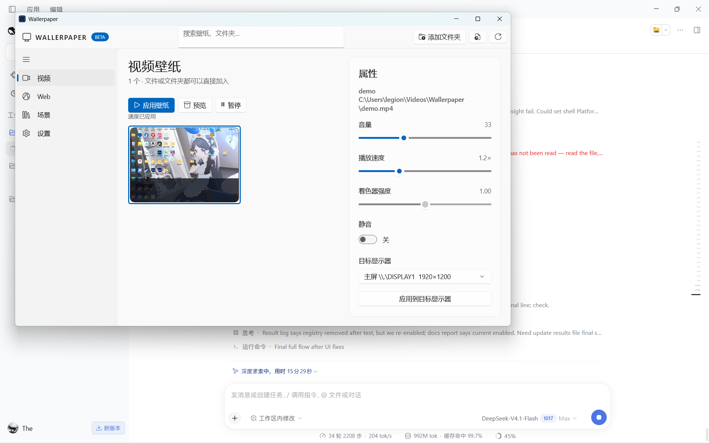
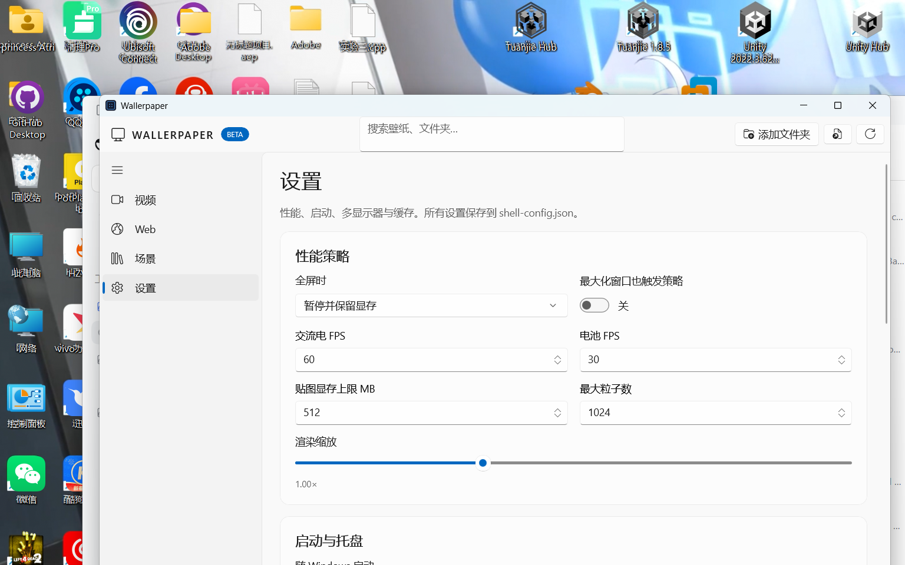

# WallerpaperShell：WinUI 3 主界面（阶段 6）



完整用户流程测试报告：[`docs/PHASE6-TEST-REPORT.md`](../../docs/PHASE6-TEST-REPORT.md)。

## 1. 页面结构

```text
MainWindow
├─ 自定义标题栏（品牌 / 搜索 / 添加文件夹 / 添加文件 / 刷新）
├─ NavigationView
│  ├─ 视频
│  ├─ Web
│  ├─ 场景
│  └─ 设置
├─ 壁纸库页（三栏）
│  ├─ 左：分类导航
│  ├─ 中：缩略图 GridView + 空状态
│  └─ 右：属性面板
│     ├─ 音量 / 播放速度 / 着色器强度
│     ├─ 静音
│     ├─ 目标显示器 + 应用
│     ├─ 多显示器提示
│     └─ 生成缩略图
└─ 设置页
   ├─ 性能策略 / 最大化策略 / AC & 电池 FPS
   ├─ 显存上限 / 最大粒子 / 渲染缩放
   ├─ 自启动 / 最小化到托盘
   ├─ 多显示器壁纸分配
   ├─ 缓存目录 / 缓存上限 / 缩略图尺寸
   └─ 设置页内小窗预览
```



### 主界面

- 分类：视频 / Web / 场景，各自扫描独立目录。
- 目录可以是文件夹，也可以是单个壁纸文件；场景目录识别 `scene.json`。
- GridView 缩略图；双击卡片直接应用，单击选中后在右侧调属性。
- 右侧属性写入 `shell-config.json`；点击“应用壁纸”会重建 `scheduler.json` 并重启调度器。
- 预览窗口：视频用 `MediaPlayerElement` 播放，场景/Web 使用缩略图静态预览，不触碰真实桌面。

### 设置页

- 性能策略：`continue/pause/stop`
- `triggerOnMaximized`
- AC / 电池 FPS
- 显存上限、最大粒子、渲染缩放
- 自启动（HKCU Run）
- 关闭主窗口时最小化到托盘
- 每块显示器独立壁纸分配
- 缓存目录、缓存上限、缩略图尺寸
- 设置页预览图

## 2. 配置文件格式

路径：

```text
%LOCALAPPDATA%\Wallerpaper\shell-config.json
```

完整示例：[`shell-config.example.json`](shell-config.example.json)

结构：

```json
{
  "version": 1,
  "general": {
    "startWithWindows": false,
    "startMinimized": false,
    "minimizeToTray": true,
    "language": "zh-CN"
  },
  "performance": {
    "policy": "pause",
    "triggerOnMaximized": false,
    "acFps": 60,
    "batteryFps": 30,
    "renderScale": 1.0,
    "maxTextureMemoryMb": 512,
    "maxParticles": 1024,
    "maxConcurrentHosts": 3,
    "pauseOnBatterySaver": false
  },
  "cache": {
    "directory": "%LOCALAPPDATA%\\Wallerpaper\\cache",
    "maxSizeMb": 2048,
    "thumbnailWidth": 480,
    "thumbnailHeight": 270,
    "keepThumbnails": true
  },
  "host": {
    "hostExe": "...\\WallerpaperHost.exe",
    "schedulerConfig": "...\\scheduler.json",
    "childExe": "...\\SceneWallpaperHost.exe",
    "videoChildExe": "...\\VideoWallpaperHost.exe",
    "webChildExe": "...\\WebWallpaperHost.exe",
    "autoStartHost": true,
    "fallbackImage": ""
  },
  "library": [
    { "path": "...", "kind": "Video", "recursive": true, "enabled": true }
  ],
  "wallpapers": [
    {
      "id": "…",
      "title": "demo",
      "kind": "Video",
      "path": "...\\demo.mp4",
      "folder": "...",
      "thumbnailPath": "...\\cache\\....png",
      "volume": 0,
      "speed": 1.0,
      "muted": true,
      "shaderParameters": { "intensity": 1.0 },
      "missing": false
    }
  ],
  "monitors": {
    "\\\\.\\DISPLAY1": { "wallpaperId": "…", "fps": 60, "enabled": true }
  }
}
```

保存策略：

- 启动 `ConfigStore.Load()` 自动加载；不存在则生成默认值。
- 原子写入：先写 `.tmp`，再 `File.Move(overwrite)`。
- 枚举用 `JsonStringEnumConverter`，写为 `"Video"/"Web"/"Scene"`。
- 加载失败回退默认配置，不阻塞启动。

### 与调度器配置的关系

Shell 配置是“用户意图”，调度器配置是“运行态”：

```text
shell-config.json
  → HostBridge.WriteSchedulerConfig()
  → %LOCALAPPDATA%\Wallerpaper\scheduler.json
  → WallerpaperHost.exe --config ...
```

映射：

| Shell | Scheduler |
|---|---|
| `performance.policy` | `policy` |
| `performance.acFps/batteryFps` | `acFps/batteryFps` |
| `performance.triggerOnMaximized` | `triggerOnMaximized` |
| `monitors[device].wallpaperId` | `monitors[device].type/path` |
| `host.childExe/videoChildExe/webChildExe` | `childExe/videoChildExe/webChildExe` |

## 3. 托盘图标

代码：[`Services/TrayIcon.cs`](Services/TrayIcon.cs)

实现要点：

- `Shell_NotifyIconW` + `NIM_ADD/NIM_MODIFY/NIM_DELETE`
- 隐藏的顶层 `STATIC` 窗口接收 `WM_APP+1`
- 右键 `TrackPopupMenuEx`
- 菜单：打开、暂停/播放、快速切换壁纸、设置、退出
- 双击托盘显示窗口

关键结构：

```csharp
NOTIFYICONDATA data = new()
{
    cbSize = Marshal.SizeOf<NOTIFYICONDATA>(),
    hWnd = _hwnd,
    uID = 1,
    uFlags = NIF_MESSAGE | NIF_ICON | NIF_TIP,
    uCallbackMessage = WM_TRAY,
    hIcon = LoadIcon(...),
    szTip = "Wallerpaper · 运行中"
};
Shell_NotifyIcon(NIM_ADD, ref data);
```

关闭主窗口：

```csharp
AppWindow.Closing += (_, args) =>
{
    if (_exitRequested) return;
    if (_config.General.MinimizeToTray)
    {
        args.Cancel = true;
        AppWindow.Hide();
    }
};
```

退出菜单显式：

```csharp
_exitRequested = true;
_tray.Dispose();
_host.Dispose();
Close();
Application.Current.Exit();
```

## 4. 自启动

代码：[`Services/AutostartService.cs`](Services/AutostartService.cs)

```csharp
const string RunKey = @"Software\Microsoft\Windows\CurrentVersion\Run";
const string ValueName = "WallerpaperShell";

using var key = Registry.CurrentUser.CreateSubKey(RunKey, writable: true);
key.SetValue(ValueName, $"\"{Environment.ProcessPath}\" --minimized");
```

- HKCU，无需管理员。
- `--minimized` 由 `App.OnLaunched` 读取，启动后直接隐藏到托盘。
- 关闭时 `DeleteValue(ValueName, throwOnMissingValue:false)`。
- 设置页切换后立即写注册表。

## 5. 壁纸缩略图生成方案

代码：[`Services/ThumbnailService.cs`](Services/ThumbnailService.cs)

### 视频

Windows Shell 缩略图：

```text
SHCreateItemFromParsingName(path, IID_IShellItemImageFactory)
IShellItemImageFactory.GetImage(
    SIZE(480,270),
    SIIGBF.ThumbnailOnly | SIIGBF.BiggerSizeOk,
    out HBITMAP)
HBITMAP → System.Drawing.Bitmap → PNG
```

- 使用系统已安装的解码器，不启动 ffmpeg/mpv。
- 失败时回退占位图。

### 场景

读取 `scene.json` 的 `layers[]`：

```text
type == "image"
texture/path/file/image → 相对 scene.json 的图片
```

取第一张存在的图片作为缩略图源；找不到则用场景类型占位图。

### Web

不启动隐藏 WebView2，生成确定性占位图：

```text
渐变背景 + "WEB" + 标题
```

这样打开分类时不会有额外 WebView2 进程/显存开销。正式版可改为离屏 WebView2 截图。

### 缓存

```text
%LOCALAPPDATA%\Wallerpaper\cache\<id>_<w>x<h>.png
```

- 相同壁纸/尺寸直接命中；
- `SemaphoreSlim(2)` 限制并发；
- 超过 `cache.maxSizeMb` 时按 `LastAccessTimeUtc` 淘汰；
- 设置页可清空缓存。

### 占位图

`System.Drawing` 生成：

- 视频：蓝色渐变
- Web：紫色渐变
- 场景：绿色渐变
- 带类型和标题，保证 UI 不为空

## 6. 属性 → Host → 子进程 IPC

属性面板不再是“只写 JSON”，而是实时链路：

```text
Slider / Toggle
  → MainWindow.SendProperty()
  → HostBridge.SetProperty(device, name, value)
  → WallerpaperHost stdin:
       { "cmd":"volume", "device":"\\\\.\\DISPLAY1", "value":25 }
  → ChildSession.SetProperty()
  → 子进程 stdin:
       { "cmd":"volume", "value":25 }
  → VideoWallpaperHost / SceneWallpaperHost / WebWallpaperHost
```

支持矩阵：

| 属性 | Video | Scene | Web |
|---|---|---|---|
| `volume` | mpv volume | —（无音频输出） | `<video>/<audio>` 元素 volume |
| `speed` | mpv playback speed | `_scriptTime += dt * speed` | media `playbackRate` |
| `shader` | —（忽略） | `shaderIntensity` → `P2.z` | —（忽略） |

- `ChildSession.SetProperty` 按 `WallpaperType` 过滤不支持的属性，不会给视频发 `shader`。
- Host 启动后先把 `scheduler.json` 中每屏的 `volume/speed/shaderIntensity` 注入子进程，再接收实时命令。
- `ChildSession` 会记录 `property volume=… sent`，便于验证。
- 场景 shader 新增内建：

```glsl
#define shaderIntensity P2.z
```

场景 shader 可以直接使用 `shaderIntensity`。

实测：

```text
[host] [\\.\DISPLAY1] property volume=0 sent
[host] [\\.\DISPLAY1] property speed=1 sent
[host] [\\.\DISPLAY1] property volume=25 sent
[host] [\\.\DISPLAY1] property speed=0.5 sent
```

视频类型不会再收到 `shader` 命令。

## 7. 预览

- 视频：独立 `PreviewWindow` + `MediaPlayerElement`，支持播放控制。
- 场景/Web：显示缩略图静态预览。
- 设置页内嵌 `Image` 小窗，不启动 WorkerW，不影响桌面。
- 完整 GPU 实时预览需要把 SceneRenderer 改为窗口模式，当前未做。

## 8. 构建与运行

要求：

- .NET 8 SDK / .NET 8 Desktop Runtime
- Windows 10 1809+ / Windows 11
- NuGet 可访问（Windows App SDK）

```powershell
dotnet restore samples\WallerpaperShell\WallerpaperShell.csproj
dotnet build samples\WallerpaperShell\WallerpaperShell.csproj -c Debug
```

运行：

```text
samples\WallerpaperShell\bin\Debug\net8.0-windows10.0.19041.0\win-x64\WallerpaperShell.exe
```

**部署时必须复制完整输出目录**，包括 `resources.pri` 和 XAML 资源；只替换 `WallerpaperShell.dll` 会导致 XAML 连接 ID 与资源不匹配，表现为 `Unable to cast IInspectable to Button`。

要真正控制桌面，把以下文件放在 Shell 同目录（或修改 `host` 配置）：

```text
WallerpaperHost.exe
SceneWallpaperHost.exe
VideoWallpaperHost.exe
WebWallpaperHost.exe
libmpv-2.dll
WebView2Loader.dll
```

已验证：选中视频 → 应用 → Shell 启动 `WallerpaperHost` + `VideoWallpaperHost`，生成 `scheduler.json`。

## 9. 测试记录

- WinUI 3 工程：`0 warnings / 0 errors`
- 主界面：视频分类、缩略图、属性面板、设置入口
- 设置页：性能策略、FPS、显存/粒子、渲染缩放、自启动、多显示器
- 自动加载：`%LOCALAPPDATA%\Wallerpaper\shell-config.json`
- Shell → Host：应用视频后进程：
  - `WallerpaperHost`
  - `VideoWallpaperHost`
- 强制结束 Shell：
  - `HostJob`（`JOB_OBJECT_LIMIT_KILL_ON_JOB_CLOSE`）随 Shell 句柄关闭；
  - `WallerpaperHost` 与 `VideoWallpaperHost` 一并退出；
  - 验证后无残留。
- 属性 IPC：
  - Host 启动即发送 `volume=0/speed=1`；
  - stdin 输入 `volume=25/speed=0.5` 后 Host 日志出现 `property ... sent`；
  - 视频类型不再收到 `shader`；
  - 场景收到 `speed=0.5/shader=1.5`，回显：
    - `{"type":"speed","value":0.5}`
    - `{"type":"shader","value":1.5}`
  - 场景 stats 在约 5 秒后显示 `time=2.5`，验证 0.5× 时间缩放。
- 完整用户流程（UIA 自动化）：
  - 启动 → 浏览视频/场景/Web → 应用 → 调音量/速度 → 预览；
  - 关闭到托盘，托盘菜单显示“打开/暂停/快速切换/设置/退出”；
  - 托盘暂停后按钮切换为“播放”；
  - 设置 AC FPS=50、自启动=开，重启后配置保留；
  - `--minimized` 模拟登录启动：主窗口不可见，Host/Video 子进程正常启动。
- 测试脚本：[`tools/ui-flow-test.ps1`](../../tools/ui-flow-test.ps1)
- 测试结果：[`tools/ui-flow-results.txt`](../../tools/ui-flow-results.txt)

## 10. 已知限制

1. 多显示器分配 UI 支持枚举和保存，但当前测试环境只有一台显示器，热插拔未实机验证。
2. Web 缩略图是占位图；要做真实截图需要隐藏 WebView2/Edge 截图服务。
3. 场景缩略图取第一张图片，不是 GPU 实时渲染首帧。
4. 属性面板已通过 Host ← Shell、Host → Child stdin 实时下发；Web 的 volume/speed 只作用于页面中的 `<video>/<audio>` 元素，页面自定义音频总线需要页面自行处理。
5. 预览窗口的视频是独立 MediaPlayer，不共享 Wallpaper 的 D3D/WorkerW 渲染。
6. 未实现 MSIX 打包、代码签名、自动更新。
7. 没有真正重启电脑；自启动用 `--minimized` + HKCU Run 模拟验证。注册表与配置当前保持开启，下次真实登录会生效。
8. 已找到 VS 2026 Community（`D:\visual studio2`），MSBuild 构建通过；WinUI C# Templates 组件因需要 UAC 提权未安装，VS XAML 设计器未验证。
9. 托盘菜单测试通过隐藏窗口 `WM_COMMAND` 回调完成，未做真实鼠标点击通知区域。
7. 托盘菜单使用 Win32 `TrackPopupMenuEx`，高 DPI 下由系统缩放。
8. 自启动路径依赖当前 exe 位置；移动安装目录后需要重新保存设置。
